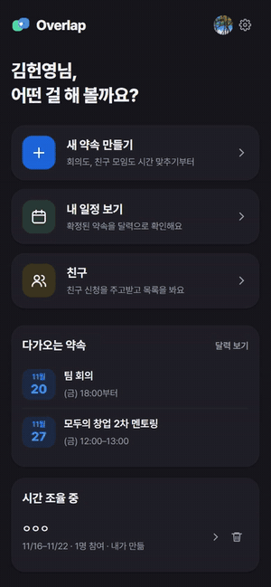
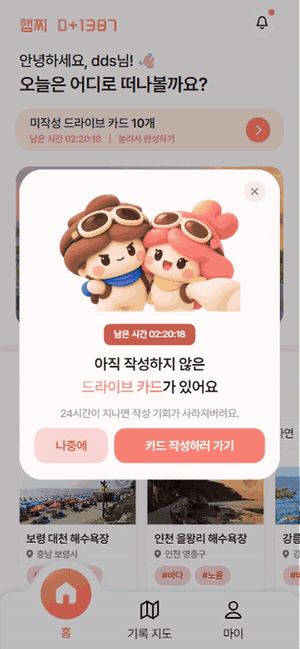
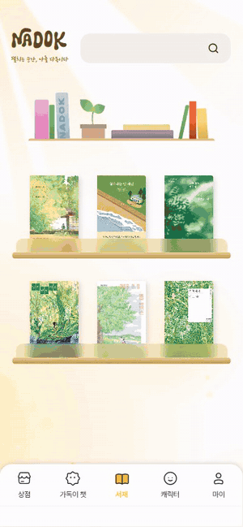

# 김헌영 | Frontend Developer

**요청이 실패하거나 연결이 끊겨도 사용 흐름이 이어지도록, 화면 상태와 복구 경로부터 설계합니다.**

---

## 🙋‍♂️ 소개

- **실제로 쓰이는 서비스를 끝까지 운영하는 신입 프론트엔드 개발자**입니다. 팀 회의 일정을 맞추느라 서너 번씩 오가던 연락을 줄이려고 만든 **Overlap**은 출시 2주 만에 **17명이 가입해 14명이 일정을 입력했고, 회의 6건을 확정**했습니다.
- 기능을 만들 때 **"이게 실패하면 사용자는 다음에 무엇을 할 수 있나"**를 먼저 정합니다. 동시 예약 경합, 채팅 전송 실패, 오프라인 진단, 배포 직후 흰 화면처럼 사용자가 막히는 지점을 찾아 복구 경로를 설계해 왔습니다.
- 팀에서는 **PR 단위로 협업**합니다. PR마다 변경 범위, 테스트·빌드 결과, 검증하지 못한 항목을 남기고, 테스트와 린트를 통과한 코드만 직접 읽고 반영합니다.

---

## 🚀 대표 프로젝트

> 각 프로젝트의 **문제와 해결 과정**은 포트폴리오 사이트에 정리했고, 문제 하나를 그대로 재현한 위젯을 **직접 눌러 볼 수 있습니다.**

<table>
<tr>
<td width="200" align="center" valign="top">

</td>
<td valign="top">
<h3>🗓️ Overlap 팀 회의 일정 조율 웹앱</h3>

 2026.11 · 개인 · 기획·개발·운영

각자 되는 시간을 칠하면 모두가 겹치는 시간을 찾아 제안합니다. 서너 번씩 오가던 일정 조율 연락을 한 번 입력으로 줄였습니다.

<b>6</b> 확정한 회의 · 2~7명 &nbsp;&nbsp; <b>14</b> 일정 입력 사용자 · 가입 17

<code>React 18</code> <code>Vite</code> <code>Supabase</code> <code>PWA</code>

<a href="https://portfoliokhy.vercel.app/projects/overlap"><b>문제와 해결 과정 · 직접 눌러 보기 →</b></a> &nbsp;·&nbsp; <a href="https://overlap-liard.vercel.app">Live</a> &nbsp;·&nbsp; <a href="https://github.com/khy1121/overlap">Code</a>

</td>
</tr>
</table>
<table>
<tr>
<td width="200" align="center" valign="top">

</td>
<td valign="top">
<h3>🚗 붕붕어스 커플 드라이브 기록 웹앱</h3>

 2026.10 – 11 · 4호선톤 해커톤 · 프론트엔드 2인

연인과 함께한 드라이브를 기록하고, 테마별 장소 추천과 기록 지도로 다시 떠날 곳을 찾는 모바일 웹앱입니다.

<b>83%</b> 커밋 410/496 · PR 80/108 &nbsp;&nbsp; <b>130</b> 테스트 파일

<code>React 19</code> <code>TypeScript</code> <code>Vite</code> <code>Storybook</code> <code>Chromatic</code>

<a href="https://portfoliokhy.vercel.app/projects/bbung"><b>문제와 해결 과정 · 직접 눌러 보기 →</b></a> &nbsp;·&nbsp; <a href="https://2026-line4thon-team6-fe.vercel.app/">Live</a> &nbsp;·&nbsp; <a href="https://github.com/2026-line4thon-team6/2026-line4thon-team6-FE">Code</a>

</td>
</tr>
</table>
<table>
<tr>
<td width="200" align="center" valign="top">

</td>
<td valign="top">
<h3>📚 NADOK 독서 기록 · 감정 분석</h3>

 2026.05 – 08 · 팀 · 프론트엔드 담당 · 🏆 교내 해커톤 대상

책을 읽고 쓴 기록을 감정 분석해 캐릭터로 보여 주는 서비스의 프론트엔드를 맡아 FE 커밋 96%를 작성했습니다.

<b>99.8%</b> 배너 용량 감소 · 8.79MB → 16KB &nbsp;&nbsp; <b>23→2.3MB</b> 첫 방문 전송량

<code>React 18</code> <code>Vite</code> <code>Tiptap</code> <code>PWA</code>

<a href="https://portfoliokhy.vercel.app/projects/nadok"><b>문제와 해결 과정 · 직접 눌러 보기 →</b></a> &nbsp;·&nbsp; <a href="https://bugitone.vercel.app">Live</a> &nbsp;·&nbsp; <a href="https://github.com/khy1121/bugitone">Code</a>

</td>
</tr>
</table>

### 다른 프로젝트

| 프로젝트 | 상태 | 기간 · 팀 | 핵심 | 링크 |
|---|:---:|---|---|---|
| 🌱 **[Cropy](https://portfoliokhy.vercel.app/projects/cropy)** 농작물 병해 AI 진단 |  | 2026.09 – · 산학협력 팀 5인 · 팀장 | ResNet50 test 93.1%, 인터넷 없이 기기에서 진단, 팀 저장소 PR 48건 | [상세](https://portfoliokhy.vercel.app/projects/cropy) · [Live](https://43.202.14.204.sslip.io/) · [Code](https://github.com/khy1121/Cropy) |
| ✈️ **[MCM Boarding Pass](https://portfoliokhy.vercel.app/projects/boardingpass)** 패션 브랜드 매장 체험 웹 |  | 2026.08 · 해커톤 팀 6인 · FE 총괄 | 커밋 75%, 실서버 API 30/31 연동, 테스트 368개 통과 | [상세](https://portfoliokhy.vercel.app/projects/boardingpass) · [Live](https://boardingpass-seven.vercel.app) · [Code](https://github.com/Hsu-Likelion-14th-Hackathon/FE) |
| 📅 **[상담 예약](https://portfoliokhy.vercel.app/projects/omfres)** 교수 상담 예약 시스템 |  | 2026.09 · 개인 | 교수 3·학생 22명 실사용, Redis SET NX로 동시 예약 차단 | [상세](https://portfoliokhy.vercel.app/projects/omfres) · [Live](https://onlyonereservation.vercel.app) · [Code](https://github.com/khy1121/omfres) |

---

## 🛠️ 보유 기술

| 분야 | 기술 |
|:---:|---|
| **언어** |    |
| **프론트엔드** |      |
| **데이터·API** |     |
| **오프라인·PWA** |     |
| **테스트·품질** |      |
| **배포·협업** |       |
| **AI·모델 (팀 프로젝트)** |    |

---

## 🧭 활동

| 기간 | 활동 | 내용 |
|---|---|---|
| 2026.09 ~ 진행 중 | **Cropy 산학협력 프로젝트** · 팀장 | 팀 5인. 기획·디자인·백엔드·모델 담당, 프론트엔드 오프라인 기능 구현 |
| 2026.03 ~ 2026.07 | **멋쟁이사자처럼 14기** · 프론트엔드 트랙 | React 과정 수료. 교내 해커톤 **대상**(NADOK), 연합 해커톤 FE 총괄(MCM) |
| 2026.08 ~ 진행 중 | **창업동아리 · 바더** · 기획 담당 | AI가 먼저 전화를 걸어 대화하고 1인칭 일기를 써 주는 서비스 기획(기획서 v1.6). 기능 명세서·화면 설계서·디자인 스펙 작성, 알파 테스트 지표 설계 |

---

## 🎓 학력 및 자격

- **한성대학교 컴퓨터공학부 웹공학트랙** · 2021.03 ~ 2027.02 (졸업예정) · 전공 평점 **3.94/4.5**
- 단과대 최우수 장학금 (3학년 2학기)
- **SQLD** (2026.09) · **정보처리기사** (2026.12 취득 예정)
- **멋쟁이사자처럼 교내 해커톤 대상** (2026.05)

---

  <a href="https://portfoliokhy.vercel.app">Portfolio</a> ·
  <a href="https://github.com/khy1121?tab=repositories">Repositories</a> ·
  <a href="mailto:rlagjsdud3@gmail.com">Contact</a>

